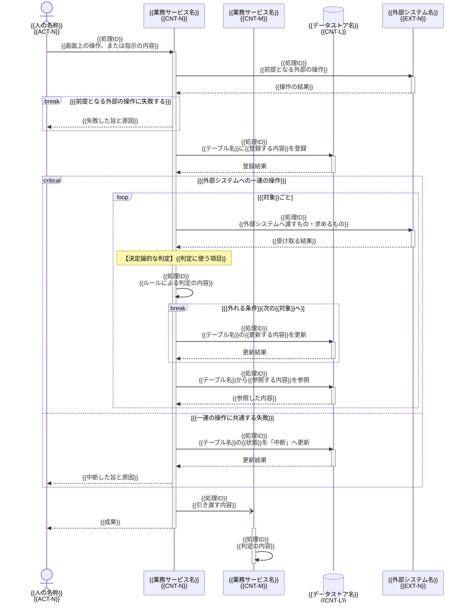

<!--
振る舞いルールは`.claude/skills/d3-c4-level2-sequences/SKILL.md`、記法の骨格は`.claude/skills/d2-c4-level1-sequences/SKILL.md`、汎用規約はリポジトリ直下の`CLAUDE.md`を参照
-->

# {{UC-N}}: {{UC名}}
## 事前・事後処理
- **事前条件**: {{開始時点の業務状態}}
- **事後条件**: 
    * {{成立したときの結果}}
    * {{ガード節で打ち切られたときの返り方}}

## シーケンス図

> ⚠️ **要確認**: {{推測・仮置きした前提}}

## 機能との対応

図の処理IDが、機能一覧のどの機能にあたるかを示します。

| 機能ID | 機能名 | 処理ID |
|---|---|---|
| {{FUNC-N}} | {{機能名}} | {{処理ID}} {{処理ID}} |
